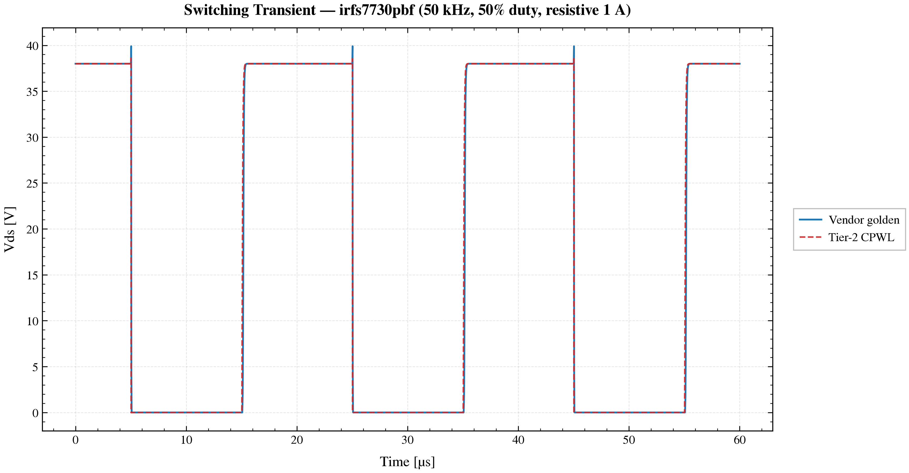
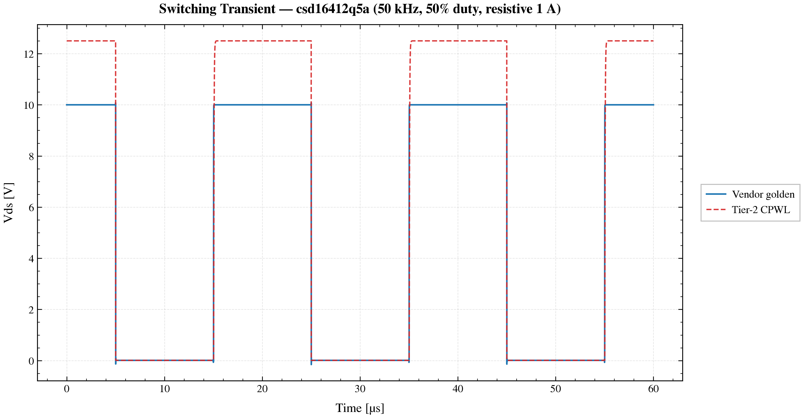
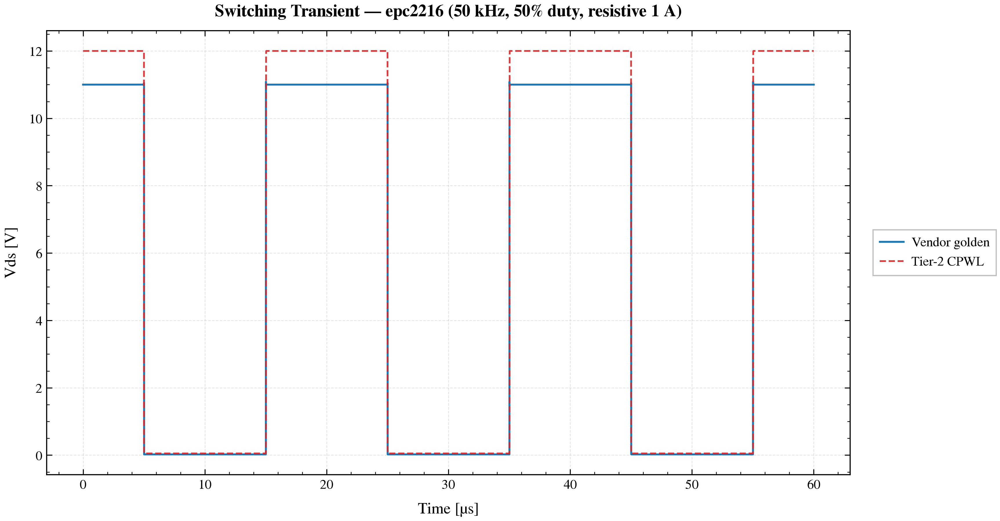
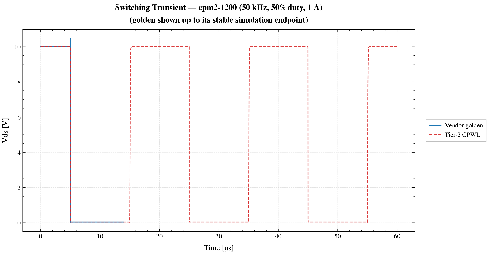

<div align="center">

# ⚡ PieceSpice

**High-Fidelity Piecewise SPICE Modeling Framework**

*PLECS-class speed. SPICE-class resolution. Standard SPICE netlists.*

[](https://www.python.org/)
[](https://www.analog.com/en/resources/design-tools-and-calculators/ltspice-simulator.html)
[](https://pypi.org/project/spicelib/)
[](#testing)
[]()
[](https://docs.astral.sh/uv/)

[](#validated-devices) [](#validated-devices) [](#validated-devices) [](#validated-devices)

*Vendor `.lib` in → validated Tier-2 CPWL macromodel out*

</div>

---

## 📖 Overview

**PieceSpice** bridges the simulation gap between full physics SPICE models
(high fidelity, hours of compute, convergence failures) and system-level
ideal-switch tools (instant, but no ringing/losses). It automatically
distills vendor MOSFET subcircuits into **Tier-2 Continuous Piecewise-Linear
(CPWL) macromodels** that:

| | Fidelity | Speed | Robustness |
|---|---|---|---|
| Vendor SPICE | ●●●●● | ●○○○○ | ○○○○○ |
| **PieceSpice Tier-2** | **●●●●○ (0.2–3.9% err)** | **●●●●○ (10–100× target)** | **●●●●● (C⁰ PWL + tanh knee)** |
| PLECS / Ideal | ●○○○○ | ●●●●● | ●●●●● |

Everything is emitted as a **standard SPICE subcircuit** — no proprietary
solver, no special runtime. Drop the generated `.lib` into any SPICE flow
that supports behavioral sources and charge-defined capacitors (validated on
LTspice 26) and simulate against the golden model. The 10–100× speedup is
the M5 target and has **not** been measured yet.

---

## ✨ How It Works

```text
                 ┌──────────────────────────────────────────────┐
 vendor .lib ──▶ │ M1/M2: EXTRACTION (LTspice testbenches)      │
                 │  7 datasheet curves per device               │
                 └──────────────────┬───────────────────────────┘
                                    ▼  config/outputs/<vendor>/
                 ┌──────────────────────────────────────────────┐
                 │ M3: APPROXIMATION ENGINES                    │
                 │  • Adaptive PWL regression  → Vth, gfs *     │
                 │  • RDP compression          → lean curves *  │
                 │  • Charge integration       → Q(V) tables    │
                 │  • C¹ knee smoothing        → tanh kernels   │
                 └──────────────────┬───────────────────────────┘
                                    ▼  PWLModelSpec
                 ┌──────────────────────────────────────────────┐
                 │ SYNTHESIS: netlist_builder                   │
                 │  tanh-knee G_CH + C_QOSS + D_BODY            │
                 └──────────────────┬───────────────────────────┘
                                    ▼
                     reports/models/<device>_PIECESPICE_T2.lib
```

`*` analysis-only (notebook 02 / `metrics.compare`); the emitted model is
built from the extracted curve rows plus the charge integration, not from
the PWLF/RDP fits.

### The Seven Datasheet Curves

| # | Curve | Extracted From |
|---|-------|----------------|
| 1 | Output Characteristics — Id vs Vds family | static sweep |
| 2 | Transfer Characteristic — Id vs Vgs | static sweep |
| 3 | On-State Resistance — Rds(on) vs Id | static sweep |
| 4 | Capacitances — Ciss/Coss/Crss vs Vds | small-signal AC |
| 5 | Gate Charge — Vgs vs Qg | quasi-static reconstruction |
| 6 | Body Diode — Isd vs Vsd | reverse-conduction sweep |
| 7 | Threshold Voltage — JEDEC constant-current | diode-connected sweep |

---

## 🧠 Modelling Approach — Behavioral Reduced-Order Modelling

PieceSpice is a **behavioral reduced-order modelling** framework: instead
of projecting the vendor model's internal state equations (POD/Krylov-style
MOR), it fits compact *behavioral* elements to the device's own extracted
response. The reduction target is structural — hundreds of internal nodes
and stiff nonlinear devices become a ~10-element subcircuit — while the
input-output behavior at the terminals is preserved against a fidelity
target measured directly on waveforms and curves.

Each macromodel is built from the device's own extracted behavior, using
the simplest formulation that preserves the physics that matter:

**Channel conduction.** The drain current is a continuous piecewise-linear
function of Vgs with one segment per extracted Vgs family, anchored at the
origin, multiplied by a `tanh` saturation knee in Vds. The breakpoints carry
the physical meaning: threshold sits at the knee, transconductance is the
post-knee slope, so the reduced parameters remain interpretable.

**Charge behavior.** Nonlinear capacitances are integrated into stored
charge Q(V) rather than used as C(v)·dv/dt — charge-conserving formulation,
so switching-loss and dv/dt predictions stay physical even under large
signal swings. The output charge Qoss is emitted as a PWL charge source;
gate capacitances are currently linear equivalents at the operating point
(a documented extension point).

**Saturation smoothing.** A `tanh` knee bounds the channel current in
saturation, keeping derivatives continuous through the transition — this is
what buys Newton robustness without sacrificing the ohmic region.

**Off-state & body diode.** The origin anchor guarantees a true blocking
state below threshold; the body diode is synthesized directly from extracted
reverse-conduction data (IS/N/RS).

The target: PLECS-class evaluation speed inside a plain SPICE subcircuit,
with error measured and bounded against the vendor golden model rather than
assumed.

---

## 🚀 Quick Start

### Prerequisites

- Python 3.11+
- [uv](https://docs.astral.sh/uv/) package manager
- LTspice 26 (system install; `LTSPICE_EXE` overrides auto-discovery)

### Installation

```bash
git clone <repo-url> PieceSpice
cd PieceSpice
uv sync
```

### Run the Full Pipeline

```bash
# 1) Extract all 7 datasheet curves from a vendor model
uv run python -c "from pipeline.curves import run_all_curves; run_all_curves('csd16412q5a')"

# 2) Fit + synthesize the Tier-2 macromodel
uv run python -c "from pipeline.fitting import fit_pwl_model; fit_pwl_model('csd16412q5a')"
```

Or via the CLI (no console script is installed, so run the module):

```bash
uv run python -m cli.main curves csd16412q5a     # all 7 curves
uv run python -m cli.main parse SpiceModels/EPC2216_V0_PSPICE.net
```

Outputs land in:

```text
config/outputs/<vendor>/        extracted curve data (YAML)
reports/models/                 synthesized Tier-2 .lib files
```

### Adding a New Vendor Model

1. Drop the vendor `.lib/.spi` into `SpiceModels/`
2. Create `config/inputs/<vendor>.yaml` (copy an existing config; set
   `library`, `subcircuit`, `pin_order_semantic`, and bias conditions)
3. `uv run python -c "from pipeline.curves import run_all_curves; run_all_curves('<vendor>')"`

Pin order is resolved semantically from the subckt header — IR/TI (D,G,S),
EPC (G,D,S), and Wolfspeed 4-port (D,G,S,Tj) layouts are handled
automatically from the YAML pin map.

---

## 🏭 Validated Devices

| Vendor | Device | Technology | Status |
|---|---|---|---|
| Infineon / IR | IRFS7730PBF | Si MODPEX LEVEL=1 | ✅ 7/7 curves |
| Texas Instruments | CSD16412Q5A | Si PSpice LEVEL=7 | ✅ 7/7 curves |
| EPC | EPC2216 | GaN eGaN (behavioral) | ✅ 7/7 curves |
| Wolfspeed | CPM2-1200-0025B | SiC bare die (Tj port) | ✅ 7/7 curves |

### Switching Transient Validation — 50 kHz / 50 % duty / 1 A resistive load

Vendor golden vs Tier-2 CPWL over three full switching cycles for each
supported device. This is the M4 *subset* (resistive load), not a
clamped-inductive double-pulse test; the CPM2-1200 golden stops before
turn-off because the vendor model aborts there (VM-10, engine-independent).

| Infineon IRFS7730PBF | TI CSD16412Q5A |
|:---:|:---:|
|  |  |
| **EPC EPC2216** | **Wolfspeed CPM2-1200** |
|  |  |

**Golden-vs-Tier-2 validation** (TI CSD16412Q5A, Vds = 10 V):

| Vgs | Vendor Golden | Tier-2 CPWL | Error |
|---|---|---|---|
| 4.5 V | 76.5 A | 76.5 A | 0.07 % |
| 5.0 V | 98.9 A | 98.4 A | 0.51 % |
| 6.0 V | 144.7 A | 144.0 A | 0.52 % |
| 8.0 V | 236.4 A | 235.1 A | 0.53 % |
| 10.0 V | 325.5 A | 323.8 A | 0.51 % |

---

## 📂 Project Structure

```text
PieceSpice/
├── approximation/        # Core algorithms: pwlf_fit, rdp_compress,
│                         # charge_model, smoother
├── cli/                  # Typer CLI entrypoint
├── common/               # Shared types, roles registry, plotting,
│                         # diagnostics (stderr dedup), plotting utils
├── config/
│   ├── inputs/           # Per-vendor simulation conditions (YAML)
│   └── outputs/          # Extracted curve data (YAML)
├── data/                 # Captured golden switching waveforms (CSV)
├── docs/                 # Reports, plans, reference notes
├── Images/               # Rendered validation figures
├── metrics/              # Static/switching/loss/comparison metrics
├── models/               # Tier-2 netlist synthesis
├── notebooks/            # 01 extraction · 02 approximation & validation
├── parser/               # Subcircuit/pin parser (dialect transpiler retired)
├── pipeline/             # run_all_curves() · fit_pwl_model(vendor)
├── reporting/            # Single-file HTML report generator
├── simulation/           # LTspice engine + benches (static/cap/gate-charge/
│                         # switching)
├── SpiceModels/          # Vendor libraries (read-only inputs)
├── tests/                # pytest suite
└── scripts/              # Utility scripts
```

---

## 🧪 Testing

```bash
uv run pytest                # 100 passed, 4 skipped (~3.5 min)
uv run pytest tests/test_pwlf_fit.py -v    # single module
```

The suite covers the parser, every approximation engine, metric math,
netlist emission, YAML I/O and the LTspice log-diagnostics layer, plus live
LTspice engine tests (transient, DC sweep, timeout, temperature). The
synthesized Tier-2 subcircuit is exercised end-to-end through
PySpice/ngspice at an operating point — that is the only remaining PySpice
use, and it is scheduled for rewrite in `docs/migration_todo.md` T6.2a
together with four skipped tests.

---

## 📓 Notebooks

| Notebook | Purpose |
|---|---|
| [`01_datasheet_curves_extraction`](notebooks/01_datasheet_curves_extraction.ipynb) | Extract the 7 datasheet curves from any configured vendor |
| [`02_piecewise_approximation`](notebooks/02_piecewise_approximation.ipynb) | Fit → compress → charge-integrate → smooth → synthesize → validate |
| [`04a_simple_switching_subset`](notebooks/04a_simple_switching_subset.ipynb) | Golden-vs-Tier-2 resistive-load switching comparison (M4 subset) |
| `03_double_pulse_transients` | *placeholder — DPT bench not implemented; no synthetic data* |
| `04_buck_converter_benchmark` | *placeholder — buck bench not implemented; no speedup numbers* |
| `05_comprehensive_validation_report` | Synthesizes Tier-2 and renders **measured** endpoint error to HTML |

---

## 🗺️ Roadmap

- [x] **M1** — Environment, Parser & SPICE Dialect Normalization
- [x] **M2** — Automated Datasheet Curves Simulation (7 curves × 4 vendors)
- [x] **M3** — Piecewise Approximation & Charge Integration Engines
      + Tier-2 synthesis + golden validation
      *(endpoint error 0.18 % EPC · 0.50 % TI · 3.45 % IRFS · 3.93 % CPM2;
      the last two are the shared-knee residual)*
- [ ] **M4** — Switching Dynamics & Double Pulse Testbench
      *(metrics + resistive-load subset done; DPT bench missing)*
- [ ] **M5** — Switched-Mode Converter Benchmark & Speedup Evaluation
      *(no wall-clock speedup has been measured yet)*
- [x] **M6** — Automated HTML Reporting & CLI Polish
      *(the report renders only metrics it is given)*

Backend: **LTspice 26 + spicelib**, out-of-process; the PySpice/ngspice path
is retired. Known limitations and vendor-model quirks are tracked in
[`vendor_model_defects.md`](vendor_model_defects.md) (VM-01…VM-12,
HOST-01/HOST-02).

---

## 🤝 Contributing Notes

- Every code change must be recorded in
  [`development-log.md`](development-log.md) (newest first, IST timestamps).
- Vendor libraries under `SpiceModels/` are **read-only inputs** — never edit.
- Plotting follows house rules: legends EAST outside the axes, 300 dpi.
- See [`piecespice_plan.md`](piecespice_plan.md) for the architecture and
  algorithm formulations.

---

<div align="center">
<sub>Built for power-electronics engineers who need both accuracy and speed.</sub>
</div>
